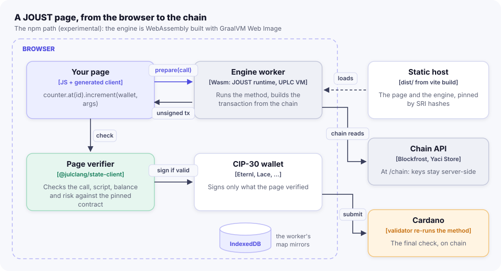

import { Aside, Steps, FileTree, LinkCard, CardGrid, Tabs, TabItem } from '@astrojs/starlight/components';

<Aside type="caution" title="Experimental">
The npm path runs JOUST's toolchain and runtime as WebAssembly built with GraalVM Web Image, which is itself experimental. Java with Gradle and cardano-client-lib is the supported, first-class path: see [Quick start: Java](/start/quick-start-java/).
</Aside>

A JOUST page prepares its own transactions. The runtime engine, about 20 MB of Wasm, runs in a Web Worker; the page
verifies every transaction the worker returns, then asks the user's wallet to sign. No backend builds anything: a
built page is static files plus a chain API. This page explains each piece: the worker, the Vite plugin, the
`virtual:joust/network` module, static builds and their integrity checks, and MerkleMap reads.

<Aside type="caution" title="Pre-release: the npm packages come from a local registry">
The npm packages are not on npmjs.org yet. Install them from a local registry, as the
[npm quick start](/start/quick-start-npm/#prerequisites) shows.
</Aside>

## The pieces



| Piece | Package | Runs in |
|---|---|---|
| `engine.worker.js` (one import) | `@julclang/joust-runtime/worker` | the worker: loads the engine, keeps MerkleMap mirrors, prepares calls |
| `engineWorker(worker, options)` | `@julclang/joust-runtime/page` | the page: a prepare service that talks to the worker |
| the client, the verifier, the chain view | `@julclang/state-client` and the generated `<Contract>.js` | the page |
| `virtual:joust/network` and the browser polyfills | `@julclang/joust/vite` | the build (or `joust dev`'s Vite) |

`@julclang/joust-runtime/page` has no dependencies, so the page's own bundle does not grow with the engine.

## The engine in a worker

The worker is one line:

```js title="page/engine.worker.js"
import '@julclang/joust-runtime/worker';
```

The page starts it as a module worker and wraps it:

```js title="page/main.js"
import { engineWorker } from '@julclang/joust-runtime/page';
import net from 'virtual:joust/network';

const service = engineWorker(new Worker(new URL('./engine.worker.js', import.meta.url), { type: 'module' }), {
  engine: net.engine, chain: net.chain, clock: net.clock, networkId: net.networkId, ttlMs: net.ttlMs,
  deployments: net.deployments, contracts: net.contracts, validators: net.validators,
});
await service.ready;   // the engine has loaded (once per page load)
```

`new URL('./engine.worker.js', import.meta.url)` is the pattern bundlers recognise: Vite builds the worker as its own
bundle. `engineWorker` returns:

| Member | What it does |
|---|---|
| `ready` | a promise that resolves once the engine has loaded in the worker |
| `prepare(request)` | a prepare service's `prepare`, so a generated client works unchanged |
| `mapValue(root, key, units?)` | a MerkleMap value from the worker's mirror ([below](#reading-merklemap-values)) |
| `deployments(d)` | new deployments for the calls that follow (after a redeploy) |
| `terminate()` | stops the worker; pending and later calls reject |

Its options are what the worker's runtime needs:

| Option | Meaning |
|---|---|
| `engine` | `{ url, integrity: { script, wasm } }`: where `joust-runtime.js` is served (its `.wasm` beside it) and the two files' SRI hashes; or just a URL, unchecked |
| `contracts`, `validators` | `contracts.json` and `validators.json` as `joust build` writes them |
| `chain` | a Blockfrost-style chain API, absolute or relative to the page |
| `projectId` | a Blockfrost project id, only for a chain API that needs one and may see it |
| `clock`, `networkId`, `ttlMs` | the network's slot clock, id and the TTL of prepared transactions |
| `deployments` | `{ [contract]: deployment }` |
| `mirrorCache` | the IndexedDB database for MerkleMap mirrors (default `"joust-mirrors"`); `false` keeps them in memory |

URLs are resolved against the page, not the worker's script, which a bundler puts elsewhere.

### The listening handshake

A module worker takes messages before its imports' top-level awaits settle (libsodium's, through
`@julclang/state-client`), and drops them silently. So the worker posts `{ joust: 'listening' }` once its message
handler is in place, and `engineWorker` posts nothing before it hears that. Each request then carries an id; the
worker answers `{ id, ok, value }` or `{ id, ok: false, error }`. A worker that cannot start at all (a module that fails
to load, memory) fires `error`, which rejects every pending and later call with `the engine worker failed: ...`.

### Loading the engine

The engine is a GraalVM Web Image: a classic script that fetches its Wasm from its own URL plus `.wasm`. A module
worker cannot `importScripts`, so the worker fetches the script, sets `__filename` to its URL, and evaluates it in the
worker's global scope ([`js/joust-runtime/src/browser/engine.js`](https://github.com/bloxbean/joust/blob/main/js/joust-runtime/src/browser/engine.js)).
Node-only modules have browser twins through `package.json` `imports` with the `browser` condition: `#engine` (this
loader) and `#file-map-store` (no file system in a page). Any bundler that honours the `browser` condition picks them.

The worker starts loading the engine as soon as it is initialised, so the first call does not wait for all 20 MB.

<Aside type="note" title="The worker is not trusted either">
The worker holds no keys. The page verifies every transaction it returns against the pinned description and
deployment before the wallet is asked, exactly as it would one from a remote service.
</Aside>

## The Vite plugin

```js title="vite.config.js"
// The page (page/) under joust dev or vite build: @julclang/joust/vite makes the runtime packages work in browsers.
import { fileURLToPath } from 'node:url';
import { joust } from '@julclang/joust/vite';

const here = (p) => fileURLToPath(new URL(p, import.meta.url));

export default { root: here('page'), build: { outDir: here('dist'), emptyOutDir: true }, plugins: [joust({ root: here('.') })] };
```

`joust({ root, network })` takes the project's root (where `joust.config.json` and `build/joust` are; default the
working directory) and, for builds, the network (below). It does five things
([`js/joust/src/vite.js`](https://github.com/bloxbean/joust/blob/main/js/joust/src/vite.js)):

- **Node polyfills.** cardano-js-sdk's crypto dependencies (`pbkdf2`, `safe-buffer`, `readable-stream`) expect Node's
  `buffer`, `events`, `util` and `stream`, and the `process` global; Aiken's MPF (the MerkleMap mirrors) uses
  `assert`. The plugin aliases them to their browser versions and injects the `Buffer` and `process` globals.
  Without them a page fails at load (`Cannot read properties of undefined (reading 'from')`). Every polyfill is
  resolved from the plugin's own package by absolute path, so it works with any `node_modules` layout (npm, pnpm,
  linked packages).
- **One `Buffer` class.** The injected `Buffer` global and every `buffer`/`node:buffer` import resolve to the same
  module, so a library that checks `instanceof Buffer` (Aiken's MPF) accepts Buffers made elsewhere.
- **es2022.** The packages use top-level await, so the dev server's dependency bundling and builds target es2022.
- **Workers.** Workers are built as ES modules with the same aliases and globals. In a worker's bundle the globals are
  injected after the CommonJS conversion (`enforce: 'post'`), or a CommonJS dependency that uses `Buffer`
  (`serialize-error`) would lose its exports. The dependency scan includes `*.worker.js` files, so Vite does not
  discover the worker's dependencies at run time and reload the page.
- **The build's clients.** The page may import `../build/joust/Counter.js` from outside its own directory: the
  project root is in Vite's `server.fs.allow`.

And it provides `virtual:joust/network`.

## `virtual:joust/network`

What the page runs on, as one default export:

| Field | Meaning |
|---|---|
| `network` | the network's name (`devkit`, `preview`, ...) |
| `networkId` | `0` or `1` |
| `chain` | the chain API for the page: `/chain`, or the network's `pageChain` |
| `clock` | `{ zeroSlot, zeroTimeMs, slotLengthMs }` |
| `ttlMs` | how long prepared transactions stay valid |
| `explorer` | the network's block-explorer transaction URL, `{tx}` for the hash, or `null` |
| `deployments` | `{ [contract]: deployment }` |
| `contracts` | `contracts.json` |
| `validators` | `validators.json` (in builds) |
| `engine` | `{ url, integrity: { script, wasm } }` |

It is resolved differently in development and in a build:

<Tabs>
<TabItem label="joust dev">

Under `joust dev` the module fetches `/joust/network.json` and then the contracts when the page loads, with
`cache: 'no-store'`. A save redeploys, so a reload picks up the new deployment. `network.json` names the engine at
`/joust/engine/joust-runtime.js`, with hashes the dev server computes from the files it serves: development runs the
same integrity check as a build.

</TabItem>
<TabItem label="vite build">

In `vite build` the module is **inlined**, for one network, from `build/joust`: `contracts.json`,
`validators.json` if there is one, and `deployments.<network>.json`. The clock is the one `joust deploy` recorded, so
a build reads no chain. The network is chosen in this order:

1. the plugin's `network` option;
2. the `JOUST_NETWORK` environment variable;
3. Vite's mode, when it names a network (`vite build --mode preview`);
4. `joust.config.json`'s `network`.

A build fails if `contracts.json` or the network's deployments file is missing (`run joust build first`,
`deploy first`).

</TabItem>
</Tabs>

## Static builds

```sh
npm run build:page          # vite build: the config's network (devkit)
npm run build:page:preview  # vite build --mode preview
```

<FileTree>

- dist/
  - index.html
  - assets/ the page's bundle and the worker's bundle
  - joust/
    - engine-1a2b3c4d/
      - joust-runtime.js the engine's script
      - joust-runtime.js.wasm the engine's Wasm module

</FileTree>

The plugin copies the engine's two files into `dist/joust/engine-<id>/`, where `<id>` is 8 hex characters derived
from the files' hashes: a new engine gets a new path, so caches never serve a stale one. The engine's URL in the page
follows Vite's `base`. The engine is loaded at run time and is not bundled; the worker's bundle itself measured 702 kB
in ADR-0015 §13.11.

`dist/` is plain static files. It needs, from wherever it is hosted:

- a **chain API** at the page's `chain`: `/chain` by default, a proxy that adds the Blockfrost project id; or a
  network's `pageChain`, an API a browser may call directly ([Networks and chain providers](/apps/networks-and-providers/));
- on DevKit, `/dev/topup` if the page offers a faucet button.

`joust serve` gives exactly that:

```sh
npm run serve               # joust serve: dist/ at http://127.0.0.1:5178, /chain, and on DevKit /dev/topup
```

It builds, deploys and bundles nothing, and has no engine route or prepare service. See the
[CLI](/apps/cli-and-projects/) and [Deploy to preview](/tutorials/deploy-preview/#5-host-it) for hosting.

## SRI: the engine is checked by its hashes

The page's own code pins the engine's sha384 hashes (`net.engine.integrity`). The worker:

<Steps>

1. fetches the script with `fetch(url, { integrity: script })`;
2. while the engine loads, wraps the global `fetch` so that the one request for `<url>.wasm` carries
   `integrity: wasm` (the engine fetches its Wasm itself);
3. evaluates the script only after the browser has accepted its bytes.

</Steps>

A browser refuses a file whose bytes differ, wherever it is served from. The engine never starts, and `service.ready`
rejects with a message that the engine `does not match its integrity hash`. `page.test.js` checks this with two
tampered builds, one character of the script and one bit of the Wasm.

So the engine can sit on a CDN you do not control. And even an engine that passed its check is not trusted with the
wallet: the page verifies what it builds.

## MerkleMap mirrors in the page

A contract with MerkleMaps keeps only each map's root on chain. The worker keeps the maps themselves, as **mirrors**
over Aiken's MPF, answers the engine's proof requests from them, and stores them in **IndexedDB** (database
`joust-mirrors`, through `level`'s browser build), so a reload or the next visit does not rebuild them. Without
IndexedDB, the worker warns and keeps them in memory. A map the page has never seen (another device, another user's
writes) is rebuilt from the chain's history, every claim checked against its root.
[MerkleMap mirrors](/apps/map-mirrors/) explains how.

### Reading MerkleMap values

A page reads a map value without a transaction through `mapValue`:

```js
const state = await token.at(id).state();                 // { admin, supply, balances: { root, reads, writes } }
const unit = deployment.policy + id;                      // the instance's token: its history rebuilds the map
const hex = await service.mapValue(state.balances.root, ownerKeyHash, [unit]);
const balance = hex === null ? 0n : BigInt('0x' + (hex || '0'));
```

`mapValue(root, key, units)` answers from the worker's mirror: the value as hex, or `null` when the key is absent. Keys
and values are the raw bytes the contract used, as hex. A root the mirror has not seen is first rebuilt from the
history of `units`. How to read the value depends on how the contract stored it: `MerkleMaps.putInt` stores a
non-negative integer as minimal big-endian bytes (zero is the empty byte string), as above.

## Explorer links

Each network may name an `explorer`: a transaction page with `{tx}` for the hash. DevKit's default is Yaci Viewer
(`http://localhost:5173/transactions/{tx}`), preview's is Cardanoscan
(`https://preview.cardanoscan.io/transaction/{tx}`). The page gets it as `net.explorer` (or `null`):

```js title="page/main.js"
const txLink = (hash) => (net.explorer
  ? el('a', { href: net.explorer.replace('{tx}', hash), target: '_blank', rel: 'noopener' }, short(hash))
  : short(hash));
```

## Without a worker

A page can also use a prepare service over HTTP: `joust dev` serves the engine in its own process at
`/joust/service`, so `httpService('/joust/service')` works during development. The page verifies that service's
transactions the same way. A built page has no such service: use the worker.

## Next steps

<CardGrid>
  <LinkCard title="The joust CLI and projects" href="/apps/cli-and-projects/" description="joust dev, joust serve and the project's outputs." />
  <LinkCard title="Networks and chain providers" href="/apps/networks-and-providers/" description="The chain API a page reads, and pageChain." />
  <LinkCard title="MerkleMap mirrors" href="/apps/map-mirrors/" description="How maps are proved, cached and rebuilt." />
  <LinkCard title="@julclang/joust reference" href="/reference/joust-cli/" description="The Vite plugin's options and the dev server's routes." />
</CardGrid>
