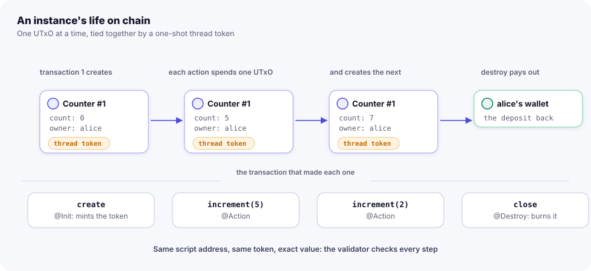

import { Tabs, TabItem, Aside, LinkCard, CardGrid } from '@astrojs/starlight/components';

A JOUST contract is a **state record** plus **pure static methods** that create, change, read and end it. This page
covers that core: the `@StateContract` options, the four method kinds and their exact signatures, how an instance is
identified, how big the state may grow, and how to keep maps and lists in the state so the chain and the JVM agree.

Every other feature (payments, authorisation, time, maps, objects) builds on what is here.

## The model in one picture

On Cardano, data lives in **UTxOs** (unspent transaction outputs): each holds some value and, optionally, a piece of
data called a **datum**. A script guards the UTxOs at its address; spending one runs the script with a **redeemer**
(the argument of the call). See the [glossary](/reference/glossary/) for these terms.

JOUST maps your contract onto that model:

- An **instance** of your contract is one UTxO at the contract's script address. Its inline datum is your state
  record, as is (no envelope), and it holds one **thread token** that names the instance.
- `@Init` creates an instance: the transaction mints the thread token and creates the state UTxO.
- `@Action` spends the state UTxO and creates the next one, with the new state.
- `@Destroy` spends the state UTxO, burns the token and pays everything out. The instance is gone.
- `@View` reads the current state. It runs only off chain and builds no transaction.



The same method runs twice: on the JVM (or in the npm engine) to compute the next state and build the transaction,
and on chain, where the generated validator re-runs it and checks that the output datum equals its result.

## A complete contract

<Tabs syncKey="lang">
<TabItem label="Java">

```java title="examples/counter/src/main/java/org/julclang/state/examples/counter/Counter.java"
@StateContract(maxDatumBytes = 128)
public class Counter {

    /** The state, stored as the inline datum of the state UTxO. */
    public record State(BigInteger count, byte[] owner) {}

    /** The deployer becomes the owner. */
    @Init
    public static State init(Ctx ctx) {
        return new State(BigInteger.ZERO, ctx.caller());
    }

    /** Anyone can increment by a positive amount (no Ctx: no signature needed, cheaper). */
    @Action
    public static State increment(State s, BigInteger by) {
        Require.that(by.compareTo(BigInteger.ZERO) > 0, "increment must be positive");
        return new State(s.count().add(by), s.owner());
    }

    /** Only the owner can reset. */
    @Action
    @OnlyOwner
    public static State reset(State s) {
        return new State(BigInteger.ZERO, s.owner());
    }

    /** Only the owner can close the counter; the deposit goes back to them. */
    @Destroy
    @OnlyOwner
    public static JulcList<Payout> close(State s, Ctx ctx) {
        return Payouts.of(s.owner(), ctx.balance());
    }

    /** Read-only view (off-chain, no transaction). */
    @View
    public static BigInteger count(State s) {
        return s.count();
    }
}
```

</TabItem>
<TabItem label=".jsc">

```jsc title="Counter.jsc"
jsc 2
package org.example.counter

// A counter anyone can increment and only its owner can reset or close.
contract Counter(maxDatumBytes = 128) {
  state { count: Int, owner: Key }

  init() {
    return { count: 0, owner: caller }
  }

  action increment(by: Int) {
    require(by > 0, "increment must be positive")
    return { ...state, count: count + by }
  }

  action reset() only owner {
    return { ...state, count: 0 }
  }

  destroy close() only owner {
    pay(owner, balance)
  }

  view current(): Int = count
}
```

`state { … }` declares the components of the generated `State` record, in order. `init` returns the first state,
every field given; an action returns the next one, `{ ...state, … }` keeping the fields it does not change.
`only owner` lowers to `@SignedBy("owner")`. See [.jsc](/languages/jsc/).

</TabItem>
<TabItem label="JavaScript">

```js title="test/counter.test.js (from the create-joust template)"
import { Counter } from '../build/joust/Counter.js';   // generated by joust-gen from the contract description

const counter = new Counter(rt.options('app.Counter')); // or new Counter({ service, chain, deployment })
const { instance } = await counter.deploy(wallet, {});   // @Init
await instance.increment(wallet, { by: 5n });            // @Action
await instance.increment(wallet, { by: 2n });
(await instance.state()).count;                          // 7n
await instance.close(wallet);                            // @Destroy
await instance.state();                                  // null: the instance is gone
```

See [JavaScript clients](/apps/javascript-clients/) for `service`, `chain` and `deployment`.

</TabItem>
</Tabs>

From this one file the JOUST annotation processor generates `CounterValidator` (compiled to UPLC by JuLC) and
`CounterClient` (the typed Java client) in the same package.

## `@StateContract` options

`@StateContract` marks the class. The class must be top-level and public. JuLC treats
`@StateContract` exactly like its own `@OnchainLibrary` (a fixed alias), so JuLC compiles the class for on-chain use
without a second annotation.

| Element | Default | Meaning |
|---|---|---|
| `maxDatumBytes` | `512` | Largest serialised state the validator accepts, between 16 and 8192. A transition whose result is larger is rejected, so no call can grow the state UTxO beyond what `minAda` covers. |
| `minAda` | `0` (derived) | Lovelace locked in the state UTxO as its min-ADA deposit, on top of the contract's funds. `0` derives it: `4310 × (160 + 200 + maxDatumBytes + 80 × assetSlots)`, rounded up to 0.1 ADA. An explicit value below that is a compile error. |
| `maxValidityMs` | `3_600_000` (1 h) | Widest validity interval, in POSIX milliseconds, that a call reading `Ctx` may use. At least 60,000. See [Time](/contracts/time/). |
| `assetSlots` | `-1` | Native assets a state UTxO may hold, for the deposit (about 80 bytes each). `-1` means 4 for contracts that handle native assets, 0 otherwise. Between 0 and 64. See [native assets](/contracts/assets-mints-sends/). |
| `stakeSelf` | `false` | Stake the state UTxOs to the contract's own script. Needs `@Withdraw` and `@Certify` handlers. See [staking](/contracts/staking-and-governance/). |

Derived deposits for lovelace-only contracts (`assetSlots` 0), as the generated clients record them:

| `maxDatumBytes` | `minAda` | Example |
|---|---|---|
| 128 | 2,200,000 (2.2 ADA) | counter, vault |
| 192 | 2,400,000 (2.4 ADA) | escrow |
| 512 (default) | 3,800,000 (3.8 ADA) | upgrade |
| 640 | 4,400,000 (4.4 ADA) | treasury |
| 1024 | 6,000,000 (6.0 ADA) | crowdfund |

The deposit stays in the state UTxO for the instance's whole life. Actions cannot spend it; a `@Destroy` pays it out.

## The state record

The state type is defined by the return type of the `@Init` method. It must be a record. Its components can be any
type JuLC can encode as Plutus data:

- `BigInteger`, `byte[]` and `boolean`;
- records and sealed interfaces declared in the contract;
- `JulcList<T>`, `JulcMap<K, V>` and `Optional<T>`;
- `MerkleMap` for unbounded maps (top-level components only; see [MerkleMaps](/contracts/merklemaps/)).

The datum on chain is the record itself, readable with the contract's CIP-57 schema. Framework data (the instance
id, the deposit) comes from the UTxO (its token name and value), not from the datum.

<Aside type="caution" title="The JuLC subset">

The whole class, views included, must stay inside JuLC's subset of Java, because JuLC compiles it as a library:
`BigInteger` (never `int` or `long`: the processor rejects fixed-width numbers, which would make the JVM and the chain
disagree), records and sealed interfaces only, no generic records, immutable locals except loop accumulators, no
`throw` (use [`Require.that`](/contracts/require-and-errors/)), and `byte[]` compared with `ByteStringLib.equals`,
never `==` or `.equals`. See [Java](/languages/java/).

</Aside>

## Method kinds and signatures

`S` is the state type. Arguments are any encodable types (as above). `Ctx` is optional, and when present it is the
last parameter (or the last before `Funds`). Every method is `public static` and not generic, and names are unique
among the annotated methods (no overloading).

| Kind | Shape | Rules |
|---|---|---|
| `@Init` | `public static S name(args… [, Ctx])` | Exactly one per contract. Its return type is the state type. Parameter names `seed`, `ctx` and `instance` are reserved. |
| `@Action` | `public static S name(S s, args… [, Ctx])` or `public static R name(S s, args… [, Ctx])` | `R` is a result record (below) with a `state` component. |
| `@Destroy` | `public static JulcList<Payout> name(S s, args…, Ctx ctx)` | `Ctx` is required: it must pay out `ctx.balance()`. May also return a result record without `state`. A contract may have several (escrow has `release` and `refund`). |
| `@View` | `public static T name(S s, args…)` | No `Ctx`. Runs only off chain; becomes a client getter. Must return a value. |

A method that takes deploy-time parameters declares the `@Params` record right after the state (first in `@Init`);
see [Params, invariants and events](/contracts/params-invariants-events/).

### Result records

JuLC rejects generic records, so there is no `Result<S>`. A method that returns more than the next state declares
its own record, and the processor recognises it **by its component names**:

```java title="examples/vault/src/main/java/org/julclang/state/examples/vault/Vault.java"
/** An action that pays out returns the next state and its payouts. */
public record Result(State state, JulcList<Payout> payouts) {}
```

| Component | Type | Where |
|---|---|---|
| `state` | the state type | required in actions, forbidden in destroys |
| `payouts` | `JulcList<Payout>` | lovelace to key hashes ([Ctx, funds and payouts](/contracts/ctx-and-funds/)) |
| `sends` | `JulcList<Send>` | any output, native assets included ([assets](/contracts/assets-mints-sends/)) |
| `mint` | `Value` | tokens under the contract's own policy |
| `accepted` | `Value` | native assets a `@Payable` method with `Funds` takes in |
| `deposits` | `JulcList<Deposit>` | payments into another instance ([deposits](/contracts/deposits/)) |
| `events` | `JulcList<E>` | authenticated events ([events](/contracts/params-invariants-events/)) |

Any other component name is a compile error. A destroy's record needs at least one of `payouts`, `sends`, `mint`
or `deposits`.

### Names

Each action or destroy becomes a redeemer variant named after the method, capitalised (`increment` →
`Increment`). The processor reports a compile error when a method or parameter name clashes with something it
generates: the client's members (`deploy`, `at`, `contract`, `state`, `instance`, `instanceId`, `lovelace`,
`fullValue`, `params`, `policyIdFor`, …), the parameter names `ctx` and `maps`, or the generated types.

## Instances and their ids

There is **one script per contract type**, not one per instance. The validator is a JuLC `@MultiValidator` with a
MINT and a SPEND side, and its hash is at once the policy id of the thread tokens and the payment credential of the
address. All instances of a contract live at that one **enterprise** script address (no stake credential, unless
`stakeSelf`).

An instance is named by its thread token:

```text
instanceId = blake2b_256(seedTxId ‖ seedIndex as 2 bytes)
```

The **seed** is any UTxO the deployer spends in the creating transaction. Each UTxO can be spent once, so each seed
gives one instance, forever. The id is 32 bytes, shown as hex.

<Tabs syncKey="lang">
<TabItem label="Java">

```java
var vault = VaultClient.deploy(runtime, alice, BigInteger.valueOf(unlockAt), ADA.multiply(BigInteger.TEN));
String id = vault.instanceId();                 // 64 hex characters

var again = VaultClient.at(runtime, id);        // reconnect later, from anywhere
BigInteger total = again.total();               // a @View: no transaction
Vault.State s = again.state();                  // the decoded datum
BigInteger held = again.lovelace();             // what the UTxO holds, deposit included
```

</TabItem>
<TabItem label="JavaScript">

```js
const { instance, txHash } = await vault.deploy(wallet, { unlockAt }, { lovelace: 10_000_000n });
const id = instance.id;                          // hex thread-token name

const again = vault.at(id);
const { state, lovelace } = await again.read();  // null once destroyed
```

</TabItem>
</Tabs>

<Aside type="caution" title="Authenticate instances by policy and id">

Ids are unique per policy only: one seed can create one instance of each contract type in the same transaction. A
dApp that trusts an instance must check both the policy id (the contract) and the instance id. Anyone can also create
an instance of your contract with any `@Init` arguments (for example naming a victim as the seller of an escrow), so a
front end should show who created an instance and with what arguments.

</Aside>

A contract without a `@Destroy` compiles with a warning: an instance can never end, so its deposit is locked forever.

## Datum size and capacity

`maxDatumBytes` bounds the serialised state. The validator checks it on every state it accepts as an output: the
initial state and every action's result. The runtime checks it first and refuses the call with a `RequireException` of this form:

```text
<Contract>.<method>: the new state is <n> bytes, over <Contract>'s maxDatumBytes (<max>)
```

Why it exists: the deposit (`minAda`) is fixed when the instance is created. If a call could grow the datum past
what that deposit covers, the next state UTxO would be below the ledger's minimum and the instance would be stuck.

The cap creates a capacity limit. An action anyone can call that grows a collection lets anyone fill it: about 13
entries of `key hash → amount` fit in the default 512 bytes. Size `maxDatumBytes` for your use, and add an economic
floor. Crowdfund sets `maxDatumBytes = 1024` and a minimum contribution of at least 2 ADA; its harness test fills the
campaign (27 backers with 2 ADA each) and checks that a refund still succeeds at capacity. Make sure the paths that
**shrink** the state (refunds, claims, destroys) always remain possible.

For maps without a practical bound, use a [MerkleMap](/contracts/merklemaps/): only a 32-byte root lives in the datum.

## Lists and maps in the state

`JulcList` and `JulcMap` are JuLC's immutable collections. They work in the state, with a few rules that come from
how they behave on chain.

### `JulcList`

The treasury keeps its council as a list of key hashes:

```java title="examples/treasury/src/main/java/org/julclang/state/examples/treasury/Treasury.java"
public record State(JulcList<byte[]> council, BigInteger quorum, boolean frozen) {}
```

Build lists with `JulcList.empty()` and `prepend`, and iterate with `for (var x : list)`. Order is part of the data:
two lists with the same elements in a different order are different states.

### `JulcMap` and `SortedMaps`

A `JulcMap` is an ordered association list:

- `insert` **prepends**; an existing key stays, so a map can hold duplicates. Update with `delete(k)` then
  `insert(k, v)`.
- `get` aborts on chain when the key is missing: check `containsKey` first.
- `getOrDefault` has no on-chain form.

There is one more trap. cardano-client-lib writes inline datums in **canonical CBOR**, which sorts map keys (shorter
key first, then byte-wise). If a state map is not already in that order, the datum written on chain differs from the
state the validator recomputes, and the call fails on chain. So keep state maps in canonical order. For the common
`JulcMap<byte[], BigInteger>`, `SortedMaps` does it on the JVM and on chain alike:

| Method | Does |
|---|---|
| `SortedMaps.put(m, k, v)` | `m` with `k` set to `v`, keeping canonical order |
| `SortedMaps.remove(m, k)` | `m` without `k` (order kept) |
| `SortedMaps.getOr(m, k, otherwise)` | the value for `k`, or `otherwise` |
| `SortedMaps.before(a, b)` | true if `a` sorts before `b` in canonical CBOR order |

```java title="examples/crowdfund/src/main/java/org/julclang/state/examples/crowdfund/Crowdfund.java"
@Action
@Payable
public static State contribute(State s, Ctx ctx) {
    Require.that(Clock.before(ctx, s.deadline()), "the campaign has ended");
    Require.that(ctx.received().compareTo(s.minContribution()) >= 0, "below the minimum contribution");
    BigInteger before = SortedMaps.getOr(s.backers(), ctx.caller(), BigInteger.ZERO);
    JulcMap<byte[], BigInteger> backers = SortedMaps.put(s.backers(), ctx.caller(), before.add(ctx.received()));
    return new State(s.creator(), s.goal(), s.deadline(), s.minContribution(), s.raised().add(ctx.received()), backers);
}
```

The runtime refuses to submit a state whose maps are out of order, before anything reaches the chain:

```text
Crowdfund.contribute: the new Crowdfund state contains a map whose keys are not in canonical order, so the datum
written on chain would differ from the one the validator recomputes. Keep state maps ordered with
org.julclang.state.api.SortedMaps
```

<Aside type="tip">

`SortedMaps` covers `byte[]` keys and `BigInteger` values. For other maps in the state, insert in canonical key order
yourself, or use a MerkleMap. In `.jsc` 2, a `Map<K, V>` is an inline map that the generated code keeps canonical, and a `BigMap<K, V>`
is a MerkleMap.

</Aside>

## What the generated validator checks

The validator wraps your methods with the invariants of [ADR-0001](https://github.com/bloxbean/joust/blob/main/docs/adr/0001-option-a-single-utxo-state-machine.md) §4. For the lifecycle:

**Create (MINT):**
- the seed named in the redeemer is spent by the transaction;
- exactly one token is minted under the policy, named `blake2b_256(seed)`, with quantity 1, and nothing else;
- exactly one output carries it, at the contract's enterprise script address, with no reference script;
- its inline datum equals `init(args, ctx)` and fits `maxDatumBytes`;
- its value is exactly the deposit plus what the caller paid in, plus the token;
- `Ctx` matches the transaction, with `balance` 0.

**Action (SPEND):**
- the spent UTxO holds exactly one thread token of the policy (UTxOs without one are junk and can never be spent);
- exactly one output carries the token, at the **same address**, with an inline datum equal to the method's result,
  within `maxDatumBytes`, and no reference script;
- its value is exactly `{lovelace: in + received − payouts, token: 1}`: no token dust, no skimming;
- that lovelace is at least `minAda`: actions never spend the deposit.

**Destroy (SPEND + MINT):**
- the thread token is burned (−1);
- the payouts add up to **everything** the UTxO holds, deposit included;
- the burn redeemer only burns.

The checks for `Ctx`, payouts, authorisation and time are on their own pages. [Security model](/contracts/security-model/)
lists them all.

## Pitfalls

- **Forgetting `Ctx` in a destroy.** It is a compile error: a destroy must pay out `ctx.balance()`.
- **Growing the state without a floor.** Anyone-callable growth plus `maxDatumBytes` is a griefing vector. Add a
  minimum amount or a signer.
- **Map order.** A `JulcMap` built with plain `insert` fails on chain as soon as keys arrive out of order. Use
  `SortedMaps`.
- **Comparing bytes.** `a == b` and `a.equals(b)` compare references on the JVM and bytes on chain. Use
  `ByteStringLib.equals(a, b)`.
- **Reading `count` from a view in a transaction.** Views never run on chain. A method that needs a value computes it
  from the state itself.

## Reference

- [Annotations](/reference/annotations/) and [State API](/reference/state-api/)
- Sources: [`StateContract.java`](https://github.com/bloxbean/joust/blob/main/julc-state-api/src/main/java/org/julclang/state/api/StateContract.java),
  [`SortedMaps.java`](https://github.com/bloxbean/joust/blob/main/julc-state-api/src/main/java/org/julclang/state/api/SortedMaps.java),
  [`ContractReader.java`](https://github.com/bloxbean/joust/blob/main/julc-state-processor/src/main/java/org/julclang/state/processor/ContractReader.java) (every rule the processor enforces)
- ADR-0001: D1 (annotations), D2 (method shapes), D6 (the datum), D8 (instance identity), §10 (capacity), §15 F13 (canonical maps)

## Next steps

<CardGrid>
<LinkCard title="Ctx, funds and payouts" href="/contracts/ctx-and-funds/" description="Receive lovelace, pay it out, and close an instance." />
<LinkCard title="Authorization" href="/contracts/authorization/" description="Decide who may call each method." />
<LinkCard title="Vault tutorial" href="/tutorials/vault/" description="A contract that holds funds, end to end." />
<LinkCard title="MerkleMaps" href="/contracts/merklemaps/" description="Maps with any number of entries." />
</CardGrid>
