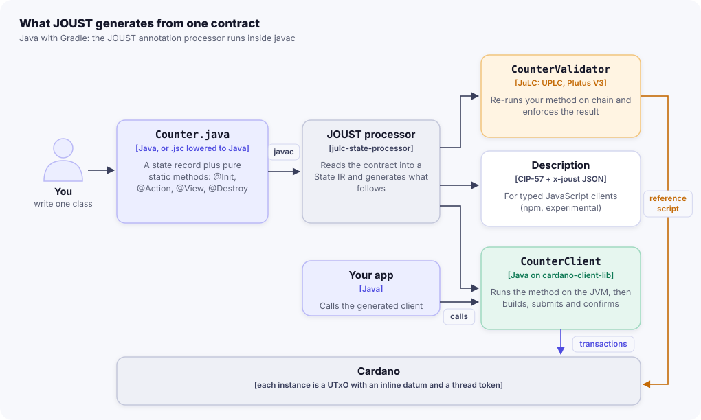
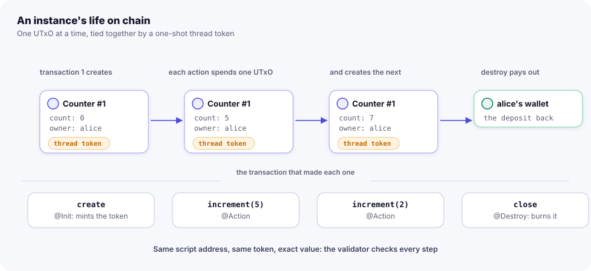
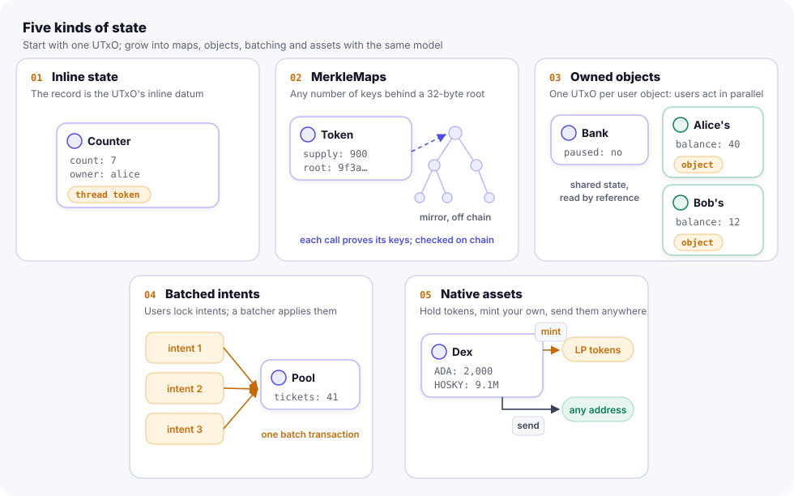
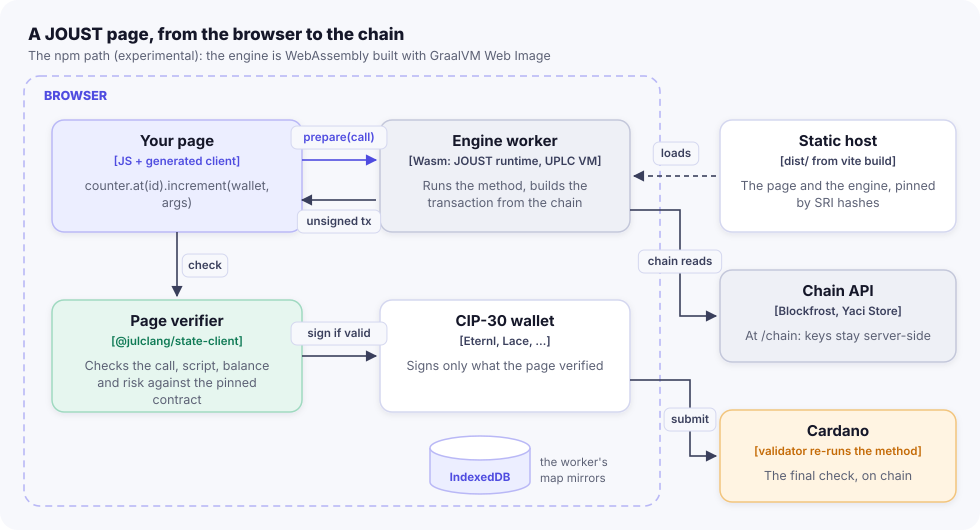

import { Aside, LinkCard, Steps } from '@astrojs/starlight/components';

This page follows one contract from source to chain: what the build generates, what the generated validator checks,
what the runtime does when you call an action, and how an instance lives as a chain of UTxOs. Read it once before
you write anything larger than a counter; the guides under "Writing contracts" build on it.

## The pieces



In detail, inside the build:

```text
            Counter.java  (or Counter.jsc, lowered to Java first)
                 |
                 v
   javac + JOUST processor (julc-state-processor)
       SubsetLint         - rejects code whose JVM and on-chain meanings differ
       ContractReader     - checks the contract's shape, builds the State IR
       ValidatorGenerator -> CounterValidator.java   (a JuLC @MultiValidator)
       ClientGenerator    -> CounterClient.java      (typed client on julc-state-runtime)
       DescriptionWriter  -> META-INF/joust/<package>.Counter.json
                 |
                 v
   JuLC annotation processor (julc-annotation-processor)
       compiles CounterValidator, Counter and the julc-state-api sources to UPLC
                 -> META-INF/plutus/CounterValidator.plutus.json
```

| Module | Role |
|---|---|
| `julc-state-api` | What contracts use: the annotations, `Ctx`, `Payout`/`Payouts`, `Require`, `Clock`, `SortedMaps`, `MerkleMaps`, `Funds`, `Send`. JuLC-compilable and JVM-runnable: its sources are shipped to JuLC as library sources |
| `julc-state-processor` | The annotation processor: `ContractReader` (shape rules), the State IR, the generators, `SubsetLint` |
| `julc-state-runtime` | The off-chain runtime the generated clients drive: locate, run, build, check, submit, confirm, retry |
| `julc-state-testkit` | `StateHarness` (evaluates the compiled validator) and `Attacks` (the attack suite) |
| `julc-state-verifier` | Shared withdraw-zero scripts: the MerkleMap verifier and the output verifier |
| `julc-state-dsl` | The `.jsc` lexer, parser, checker and lowering to Java |
| `julc-state-server` | The prepare service: generated clients over HTTP, for JavaScript pages |

## Build time: two annotation-processing rounds

<Steps>

1. **Round 1: JOUST.** javac runs `JoustProcessor` on every class annotated `@StateContract`.
   - `SubsetLint` checks the class first (syntactic pass now, typed pass once javac has attributed it). It rejects
     `int`, `long` and other fixed-width numbers, narrowing calls such as `intValue()`, and other constructs that
     would run differently on the JVM and on chain. See [Java](/languages/java/).
   - `ContractReader` checks the contract's shape (exactly one `@Init`, `public static` methods, `Ctx` last, field
     names that `@OnlyOwner` or `@ValidAfter` point at, reserved names) and reports each problem as a compiler
     error on the offending element.
   - It builds the **State IR** (`org.julclang.state.processor.ir`: `ContractIR`, `TransitionIR`, `ViewIR`,
     `ParamIR`), which records the storage, execution and transaction-level strategy of the contract.
   - The generators write `<Name>Validator.java`, `<Name>Client.java` and the description into the contract's
     package. With `-Ajoust.portable=true` they also write `<Name>Portable` (experimental, for Wasm pages).

2. **Round 2: JuLC.** JuLC's annotation processor finds the generated `@MultiValidator` and compiles it to UPLC,
   together with everything it calls: your contract class (JuLC treats `@StateContract` as an alias of its
   `@OnchainLibrary`, so the class is an on-chain library) and the `julc-state-api` sources it finds on the
   annotation processor path. The compiled script lands in `META-INF/plutus/<Name>Validator.plutus.json`, where
   the runtime and the testkit load it.

</Steps>

Code is generated from string templates, so every construct emitted is one JuLC is known to accept
([ADR-0001](https://github.com/bloxbean/joust/blob/main/docs/adr/0001-option-a-single-utxo-state-machine.md) §2).

## The generated validator

One script per contract type, many instances. `<Name>Validator` is a JuLC multi-validator with a **MINT** and a
**SPEND** entry point, so its policy id, its script hash and its address credential are the same 28 bytes. Every
instance of the contract lives at that one address.

An instance is identified by its **thread token**: a native token minted under the contract's own policy, exactly
once, whose name is `blake2b_256(seedTxId ++ I2OSP(seedIndex, 2))` for a seed UTxO the deployer spends. That
32-byte name is the **instance id**. Because the seed can only be spent once, the id can only ever be minted once.

The redeemers are generated from your methods. For the counter:

```java title="build/generated/.../CounterValidator.java (excerpt)"
public sealed interface Lifecycle permits CreateInstance, BurnInstance {}
public record CreateInstance(TxOutRef seed, Ctx ctx) implements Lifecycle {}
public record BurnInstance() implements Lifecycle {}
public sealed interface Calls permits Increment, Reset, Close {}
public record Increment(BigInteger by) implements Calls {}
public record Reset() implements Calls {}
public record Close(Ctx ctx) implements Calls {}
```

Each spend arm decodes the current state from the input's inline datum, re-runs your method and checks the result.
This is the generated `reset` arm, unedited:

```java title="build/generated/.../CounterValidator.java (excerpt)"
static boolean onReset(Reset r, Counter.State current, TxInfo tx, TxInInfo own, byte[] policy, byte[] id, BigInteger inLovelace) {
    boolean signed_owner = ContextsLib.signedBy(tx, current.owner());   // @OnlyOwner
    Counter.State next = Counter.reset(current);                        // your method, on chain
    boolean continues = continues(tx, own, policy, id, (PlutusData) (Object) next, inLovelace.add(BigInteger.ZERO));
    return signed_owner && continues;
}
```

`continues(...)` checks the invariants every action shares: exactly one output carries the thread token, at the same
address, with an inline datum equal to `next`, no reference script, a datum within `maxDatumBytes`, and a value of
exactly `{lovelace, policy.id: 1}` with the min-ADA deposit untouched.

What the generated code checks, by kind of call:

| Call | Checks |
|---|---|
| **Create** (MINT `CreateInstance`) | The seed is consumed; exactly one token is minted under the policy, named by the seed; one output carries it, at the script address with no stake credential and no reference script; its datum equals `init(...)`; its value is exactly `minAda + received` plus the token; `Ctx` is valid with `balance == 0` |
| **Action** (SPEND) | The input holds a thread token (otherwise it is junk and unspendable); policy annotations hold against the current state; `Ctx` matches the transaction if the method declares it; the continuing output is exact; each payout is paid and tagged |
| **Destroy** (SPEND + MINT `BurnInstance`) | As an action, plus: the payouts total everything the UTxO holds, deposit included; the thread token is burned (quantity -1); the burn redeemer only burns |

**`Ctx` is checked, not trusted.** The client puts the `Ctx` it used into the redeemer, and the validator checks
that every field equals the transaction's facts before calling your method: `caller` signed, `received` matches the
value added (zero unless `@Payable`), `balance` equals the input's lovelace minus the deposit (everything, in a
destroy), and `validFrom`/`validTo` equal the transaction's finite validity bounds, at most `maxValidityMs` apart.
A method without `Ctx` gets none of these checks, and is cheaper.

**Payouts are tagged.** A payout output must go to the recipient's key and carry, as its inline datum, the
`TxOutRef` of the state input that owes it. Two instances spent in one transaction can therefore never count the
same output (double satisfaction).

The full list, with the attack that each check stops, is in [Security model](/contracts/security-model/) and
ADR-0001 §4.

## The generated client and the runtime

`<Name>Client` is a thin, typed facade. Each method fills in a `Call` (or a `Deploy`) with lambdas that run your
method and build the redeemer, and hands it to the runtime. The generated `reset`:

```java title="build/generated/.../CounterClient.java (excerpt)"
public CallResult<Counter.State> reset(Account callerAccount) {
    return instance.call(Call.<Counter.State>action("reset", callerAccount)
            .usesCtx(false)
            .signedBy("owner", s -> s.owner())
            .run((s, ctx) -> Transition.of(Counter.reset(s)))
            .redeemer(ctx -> new CounterValidator.Reset())
            .build());
}
```

When you call `counter.reset(alice)`, the runtime (`StateInstance.call`) does this:

<Steps>

1. **Locate** the state UTxO by its asset unit (policy id followed by the instance id) at the contract address,
   and decode the state from its inline datum.
2. **Pre-check** the policy annotations: if the caller's key is not the one in `owner`, throw a
   `RequireException` now.
3. **Pick the time window** if the call reads `Ctx` or has a time annotation: slots first (tip to tip + TTL), then
   the milliseconds derived from them, so the JVM run and the on-chain run see identical numbers.
4. **Run your method on the JVM** with the decoded state and a `Ctx`. A failing `Require.that` throws here, and
   nothing has been built.
5. **Build the transaction** with cardano-client-lib's QuickTx: spend the state UTxO with the redeemer, read the
   script from its reference-script UTxO, add the continuing output (exact value, inline datum), the tagged payouts,
   the validity interval and the required signers.
6. **Evaluate, sign and check:** execution budgets come from the configured evaluator (JuLC's local one in the
   examples). Before submitting, the runtime checks that the balanced transaction still has exactly the expected
   state output and payouts.
7. **Submit and confirm:** wait for this transaction to be included, then until the indexer shows the new state.

</Steps>

**Contention.** One state UTxO can be spent by one transaction. If the node rejects a submission and the state has
moved, the runtime re-reads, re-runs your method on the new state and resubmits, up to `maxRetries` times
(`ContentionException` after that). Once a submission has been accepted it never resubmits: if confirmation times
out you get a `PendingTransactionException` with the hash.

The first `deploy` of a contract on a network also publishes its script as a **reference script** (a UTxO holding
the script, at the contract's own address; CIP-33), so later transactions read the script instead of carrying it.

## An instance's life, as UTxOs



With the redeemers and the instance id:

```text
 deploy                       action                        action                       destroy
 (MINT CreateInstance)        (SPEND Increment)             (SPEND Reset)                (SPEND Close + MINT BurnInstance)

 seed UTxO (caller) --+
                      |
                      v
              +----------------+            +----------------+           +----------------+
              | state UTxO #1  |  ------->  | state UTxO #2  |  ------>  | state UTxO #3  |  ------>  payouts, tagged with
              | datum: init()  |            | datum: incr()  |           | datum: reset() |           state UTxO #3's ref;
              | 2.2 ADA        |            | 2.2 ADA        |           | 2.2 ADA        |           thread token burned
              | + thread token |            | + thread token |           | + thread token |
              +----------------+            +----------------+           +----------------+
                  instance id = blake2b_256(seed tx id ++ seed index): the same token travels through every state
```

Each transition spends the current state UTxO and creates the next one. The thread token moves with the state, so
"the counter" is "the UTxO holding token `policy.instanceId`". The deposit (`minAda`, 2.2 ADA for the counter,
derived from `maxDatumBytes`) stays locked for the instance's whole life and is paid out by the `@Destroy`.

## Storage strategies



The single state UTxO above is **INLINE** storage: the whole state is the datum, and every call spends it. That is
right for most contracts, but it allows about one update per block and holds only what fits in `maxDatumBytes`.
JOUST offers other strategies, chosen by how you declare the state:

| Strategy | You declare | For | Guide |
|---|---|---|---|
| Inline (Option A) | A state record | Contracts with modest state and modest traffic | [State and lifecycle](/contracts/state-and-lifecycle/) |
| MerkleMap (Option B) | A `MerkleMap` component in the state | Unbounded maps (balances, registries): the datum keeps a 32-byte root, each call proves the keys it touches, checked by the shared map verifier | [MerkleMaps](/contracts/merklemaps/) |
| Owned objects (Option C) | An `@Owned` record and owned methods | Per-user objects in their own UTxOs, beside shared state read by reference, so users do not contend | [Owned objects](/contracts/owned-objects/) |
| Batched intents (Option D) | `@Batched` on an action | Hot shared state: users lock requests in parallel, a permissionless batcher applies them in one transaction | [Batched intents](/contracts/batched-intents/) |

On top of these: native assets and contract-minted tokens, deploy-time parameters, quorums and script callers,
invariants and events, staking and governance purposes, composition of several contracts in one transaction, and
upgrades. Each has a guide under "Writing contracts", and an ADR in
[`docs/adr`](https://github.com/bloxbean/joust/tree/main/docs/adr).

## The npm and Wasm path



JavaScript developers use the same processor, validators and runtime, compiled to WebAssembly by JOUST's own build
(ADR-0015), so they need Node and nothing else.

- **The toolchain engine** (in `@julclang/joust`) runs the build in Node: `.jsc` lowering, javac with the JOUST
  processor, and JuLC's compiler, with no JDK. It writes the compiled validators, the descriptions and typed
  JavaScript clients.
- **The runtime engine** (in `@julclang/joust-runtime`) runs JOUST's runtime in Node or in a page's Web Worker. It
  prepares each transaction from a call request and the chain data it asks for; the JavaScript side does all the I/O.
- **The page verifier** (in `@julclang/state-client`) checks every prepared transaction against the contract's
  description and the chain before a CIP-30 wallet is asked to sign. CIP-30 is the standard browser-wallet API
  (Eternl, Lace and others).
- **The prepare service** (`julc-state-server`) is the JVM alternative: it serves generated Java clients over HTTP,
  prepares unsigned transactions for a wallet address, and holds no keys.

<Aside type="note">

The npm packages are not released yet (npmjs.org holds placeholders only). The quick start installs them from a local registry. Details of
the JavaScript side are in [Quick start: npm](/start/quick-start-npm/) and
[JavaScript clients](/apps/javascript-clients/).

</Aside>

## Next steps

<LinkCard title="Quick start: Java & Gradle" description="Set up a project and run the counter on DevKit." href="/start/quick-start-java/" />
<LinkCard title="Your first contract" description="Every part of the counter, explained." href="/start/first-contract/" />
<LinkCard title="Security model" description="Each invariant, and the attack it stops." href="/contracts/security-model/" />
<LinkCard title="Java off-chain runtime" description="StateRuntime, clients, Compose and wallets." href="/apps/java-runtime/" />
